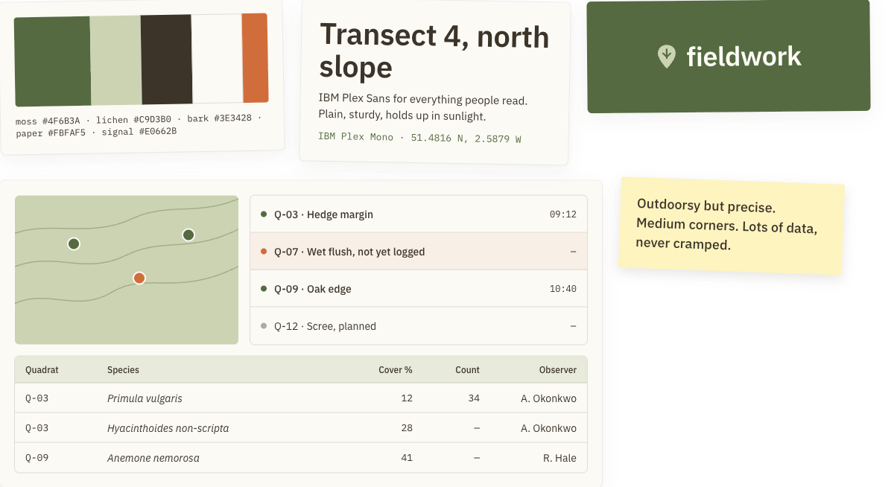
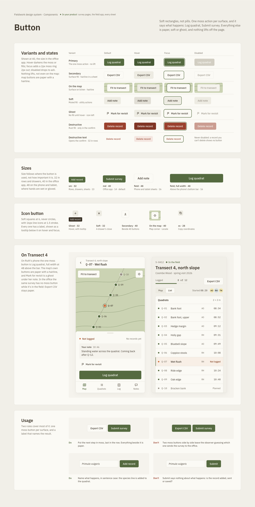

# Planed design system kit

Turn a moodboard into a design system in your own Paper File. Drop your references on the Start here page and run one prompt in your AI agent. It sets up the 98 tokens from your moodboard, then rewrites the 7 Foundations pages and the 15 core Components pages with your product’s names, sample data and shapes. A second prompt does the other 22 Components pages.

The kit is a sample system for a made-up product (Fieldwork, a survey and field-notes app for ecologists), and your agent restyles it into yours. It comes from [Planed](https://planed.cc/design-system) and it’s MIT-licensed.

**Needs a paid Paper plan (the MCP makes a lot of calls).** You also need an AI agent that loads Agent Skills. The kit is built for Claude Code.





**See it as an app.** Fieldwork’s sign-up and onboarding, built from this kit, run as a clickable Prototype in Planed, with hover and pressed states and transitions: [open the Fieldwork prototype](https://www.planed.cc/i/IbojcmTLqhq7GfK7yonM3g-anon). No account needed. The screens are in [their own Paper File](https://app.paper.design/file/01M89DV7JTFS9VQ5Q4SWR1CEWY), one page per route.

## How it works

1. **Get your own copy.** Open the [Planed design system kit](https://app.paper.design/file/01M893XQADCXH6Y0W6JCJZJK2E) in Paper. It’s view-only, so:
   - Make a new Paper File of your own.
   - Copy every page into it, keeping the page names exactly: “Start here”, “Readme”, the Foundations and Components names, and “Patterns”.
   - The boards look unstyled in your copy until your agent’s run creates the tokens. That’s expected.
   - If a paste fails, copy page by page.
2. **Drop your moodboard on Start here.** Screenshots you like, your logo, type you’d use, a screenshot of your product. A sentence about what your product does helps too.
3. **Paste the prompt** into your AI agent, with the Paper MCP connected and your file open in Paper:

   ```
   Install the planed-design-system skill from github.com/Mlock/planed-design-system.
   Generate my design system in this file from the moodboard on Start here.
   ```

   To install it by hand in Claude Code, copy `skills/planed-design-system` from this repo into `~/.claude/skills/` (or into `.claude/skills/` inside a project), start a new session and paste only the second line.

### What the agent does

It reads your moodboard. If the images leave something open, it asks you at most three questions: your product’s name, what it does, and light or dark. Then it posts a brief in chat (a mood word, palette roles, a type pair, shape language, density, voice, and your product’s nouns) and carries on. You can redirect it while it works.

It sets the colour, type and radius tokens first, so every page changes at once. Then it rewrites the 22 core pages: Button and Layout first, so every other page has a finished page to match and one app window to reuse, then the rest four at a time. Your copy and sample data replace Fieldwork’s, and each In context section shows a scene from your product. Components take your shapes too, so buttons get rounder or squarer, tabs may become a segmented control, and inputs come filled or outlined. A review pass checks each set of four. Pages your product doesn’t need are removed, and the agent tells you which. Last, it rewrites the Readme with five rules drawn from your brief.

The Patterns page starts with one board, for screenshots of your real product. Add them when you’re ready and say “now do Patterns” for a second run.

A first run on the 22 core pages processes about 6–10M tokens on your own agent plan, makes roughly 1,500–3,700 Paper calls and takes about 30–90 minutes, measured across three dry runs, each stopped early by a lower ceiling; the agent now allows up to about 12M before it stops adding review rounds. Say “do the rest” afterwards for the other 22 Components pages, a second run of about the same size. Add `--thorough` to the prompt for a stricter review, which takes more rounds and more tokens.

**One page at a time.** Add “one page at a time” to the prompt and the agent sets up your brief and tokens, builds the Button page, and stops so you can look. Then say “next page”, or name one (“do Card”). It keeps your brief in a file in your working folder (`design-brief-<your system>.md`), so later pages can run in a new session.

**Reviewer off.** Add `--no-review` (or say “review off”) to skip the review rounds: the agent still runs its checks on every page and compares each with your Button page, but no reviewer looks at it. Runs are faster and use fewer tokens; in the dry runs, review and fix rounds were up to about half of a first run. Say “review on” to bring it back.

In plan terms: a run uses a lot of tokens, so on a plan with a usage cap it may stop partway. When your usage resets, say “do the rest” and the agent picks up the pages it hadn’t done.

A run may end with a few pages (three to six in the dry runs) listed under "Worth a look": fixes the agent couldn’t re-review before its token ceiling, a font it had to substitute, or a choice it had to infer. The agent tells you which.

### At the end

The agent turns the example board on Start here into yours: your system shown inside Planed, with Comments pinned on it, the way your team would see it. Planed turns a Paper File into a clickable Prototype for Reviewers. More at [planed.cc/design-system](https://planed.cc/design-system).

## Install

**Claude Code, as a plugin.** In Claude Code:

```
/plugin marketplace add Mlock/planed-design-system
/plugin install planed-design-system@planed-design-system
```

**Claude Code, by hand.** Copy `skills/planed-design-system` from this repo into `~/.claude/skills/` (or into `.claude/skills/` inside a project), then start a new session and paste only the second line of the prompt.

**Other agents.** The skill is a standard Agent Skill: a folder with a `SKILL.md` and a `references/` folder. Put `skills/planed-design-system` wherever your agent loads Agent Skills from. Your agent also needs the Paper MCP connected.

Then open your Paper File in Paper and paste the prompt from step 3 above. If the skill is already installed, paste only its second line. Later, say “do the rest” for the other 22 Components pages, and “now do Patterns” once your product screens are on the Patterns page.

## What’s in this repo

- `skills/planed-design-system/SKILL.md`: the workflow your agent follows.
- `skills/planed-design-system/references/`: the page pattern, every page’s notes, the tokens, moodboard reading and the ledger, Paper quirks, lint, the builder and reviewer briefs and the preview board with its copy.
- `.claude-plugin/marketplace.json`: lets `/plugin` install the skill.
- `docs/`: the two images in this README.

## Licence and brand

The skill, and the structure and content of the Paper File, are MIT-licensed (see LICENSE). That includes Fieldwork, the sample system, and the example moodboard tiles on Start here. Fieldwork, fernhill and the coffee app are invented.

The Planed name, the plane mark and the look of the Planed viewer are Planed’s and aren’t covered by the licence. The kit uses them on Start here (the preview board and the eyebrow), in the Paper File’s name and in the Readme’s credit and licence lines, to show where the kit comes from. Please keep them out of your own product.
